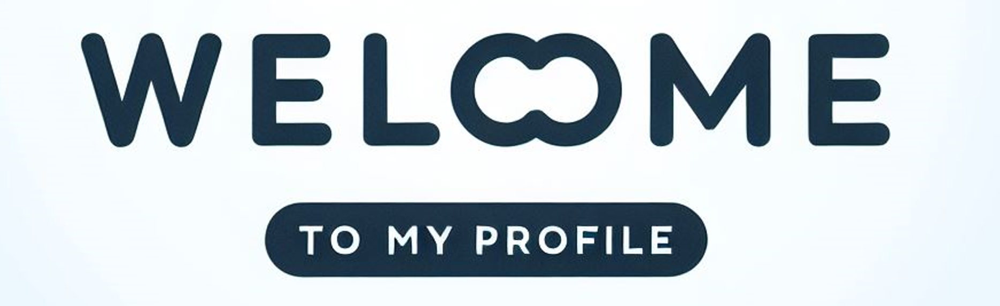

  <!-- Welcome Banner -->
  

      
  

  

  <!-- Intro Bio -->
  

    Hi, I'm <a href="https://github.com/Kuldar" style="color: #58a6ff; text-decoration: none; font-weight: 600;">Kuldar</a> — Full-Stack Software Engineer specializing in <b>AI Microservices</b>, <b>EdTech Solutions</b>, and <b>Automated Security Pipelines</b>.
  

  
  

  <!-- Tech Stack Section -->
  <h2 align="left" style="color: #58a6ff; margin-bottom: 15px;">🛠️ Tech Stack & Ecosystem</h2>
  

    
<b>Languages:</b> TypeScript / JavaScript, Python, HTML5/CSS3, SQL

    
<b>Frontend:</b> Vue.js, React, Vite.js, Modern Responsive UI Design

    
<b>Backend & AI:</b> Node.js, FastAPI / Python REST APIs, LTI 1.3 Standards, LLM Orchestration

    
<b>DevOps & Tools:</b> Docker, Linux System Administration, Git, CI/CD, Automated Testing (ART)

  

  

  <!-- Systems & Architecture Section (Addresses Private Repos) -->
  <h2 align="left" style="color: #58a6ff; margin-bottom: 15px;">🧩 Complex Systems & Architecture Highlights</h2>
  <blockquote align="left" style="border-left: 4px solid #58a6ff; padding-left: 15px; color: #8b949e; font-style: italic; margin-bottom: 20px;">
    Note: Primary production codebases (TalTech research & enterprise integrations) reside in private organizational repositories. Architecture breakdowns and functional summaries are highlighted below.
  </blockquote>

  

    
    <h3 style="color: #f0f6fc; margin-bottom: 5px;">⚡ Automated AI Security & Penetration Pipeline</h3>
    

      Designed an automated testing pipeline using LLMs in a sandboxed development environment to simulate penetration testing and solve LMS quizzes, benchmarking curriculum resilience against AI solvers.
    

    <h3 style="color: #f0f6fc; margin-bottom: 5px;">📦 EdTech LTI 1.3 Course Archive Ingestion Engine</h3>
    

      Architected a full-stack system leveraging Vue.js/React and LTI 1.3 protocols to ingest, unpack, and parse complex Moodle course archive files (<code>.mbz</code>) for automated resilience testing.
    

    <h3 style="color: #f0f6fc; margin-bottom: 5px;">🐳 Containerized Microservices & Automated Resilience Testing (ART)</h3>
    

      Engineered modular, Dockerized microservices evaluating operational, pedagogical, and security challenges across digital learning management systems.
    

  

  

  <!-- Code Philosophy -->
  <h2 align="left" style="color: #58a6ff; margin-bottom: 15px;">📐 Engineering Philosophy & Clean Code</h2>
  

    
🔹 <b>Maintainable Architecture:</b> Emphasis on strict typing, modular separation of concerns, and reusable microservices.

    
🔹 <b>Security & Standards:</b> Deep integration with industry protocols (LTI 1.3) and sandboxed LLM execution.

    
🔹 <b>Automated Quality:</b> Test-driven evaluation pipelines to measure operational reliability and systemic resilience.

  

  

  <!-- Connect Section -->
  <h2>Let's Connect</h2>

  

    📧 Open to technical discussions via <a href="https://github.com/Kuldar9/Kuldar9/discussions/1" style="color: #58a6ff; text-decoration: none; font-weight: 600;">Discussions</a> or <a href="https://github.com/Kuldar9/Kuldar9/discussions/2" style="color: #58a6ff; text-decoration: none; font-weight: 600;">General Thread</a>.
  

  

    🌐 Portfolio & Projects: <a href="https://kuldar9.github.io/" style="color: #58a6ff; text-decoration: none; font-weight: 600;">kuldar9.github.io</a>
  

   

  <!-- Under Construction GIF -->
  

      
  

